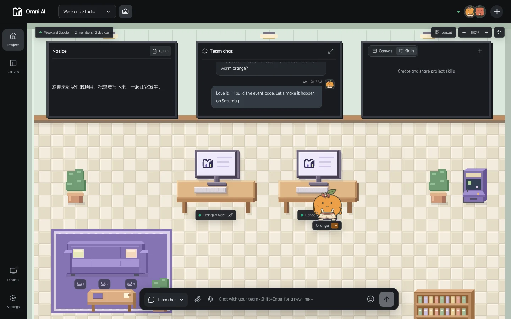
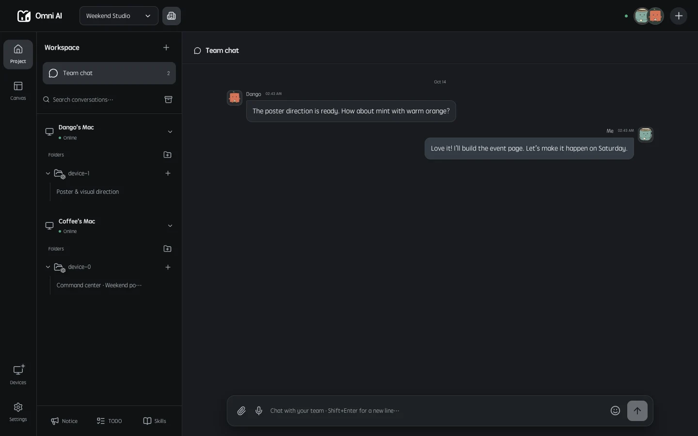
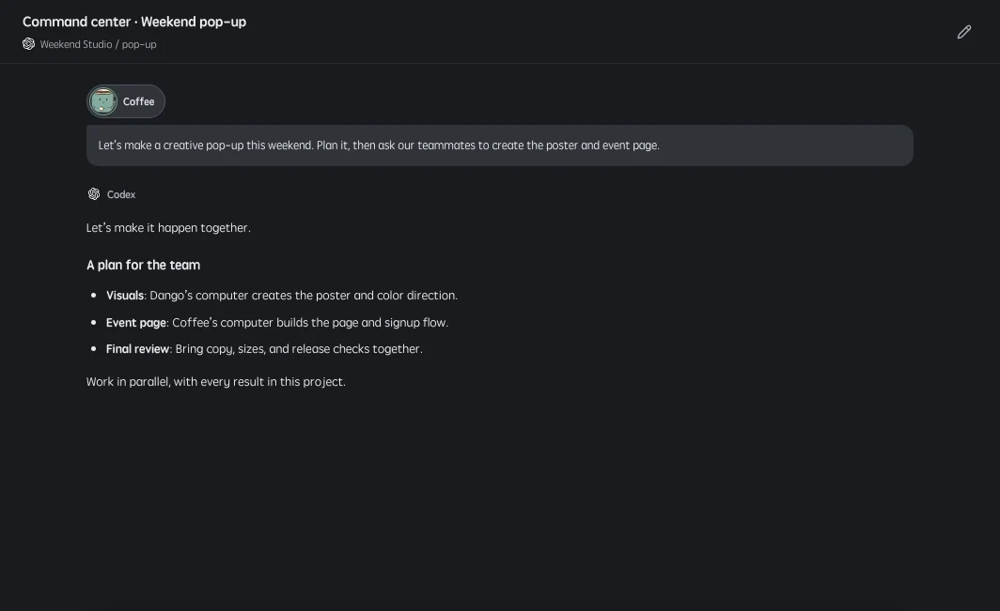

<p align="center">
  <a href="https://wanwu321.com/"></a>
</p>

<h1 align="center">Omni CLI</h1>

<p align="center">Bring headless computers into your team's AI workspace.</p>

<p align="center">
  <a href="README.md">简体中文</a> · <strong>English</strong> · <a href="https://wanwu321.com/">Omni AI website</a> · <a href="https://github.com/EdenShadow/omni_cli/issues">Report an issue</a>
</p>

<p align="center">Windows · macOS · Linux · Node.js 24+</p>



*Product image from the Omni AI website. Team members use this project interface in the web or desktop client; Omni CLI runs in a terminal without loading that interface.*

## What is Omni CLI?

Omni CLI is the command-line device client for **Omni AI (万物 AI)**. It connects an existing **Codex, Claude Code or DeepSeek Harness** installation to your Omni account and projects, so your team can use shared sessions, assign work through team chat, and share skills and results.

Use it on a headless Linux server or a Windows/macOS computer where you do not need the desktop interface. It does not bundle an Electron UI, remote desktop service or Omni's own AI runtime. It uses AI terminals you have already installed and signed into.

**Website: [wanwu321.com](https://wanwu321.com/)** · **Source: [EdenShadow/omni_cli](https://github.com/EdenShadow/omni_cli)**

## What can you do with it?

| Capability | How it works |
| --- | --- |
| Connect a device | Sign into Omni in your terminal; the device appears under your account |
| Bind AI terminals | Detect the three supported terminals and choose one or more to bind |
| Use sessions | Start with a default workspace or import all existing sessions from selected terminals |
| Collaborate in projects | Add the device to a project so authorized members can use shared sessions |
| Assign work in chat | Select an `@session` in team IM; the device runs the request and returns replies and attachments |
| Use skills | Install default skills and receive team skill updates for project collaboration |
| Stay connected | Reconnect automatically and retry unacknowledged results while retaining local work files |

Task flow: **a member submits a request → Omni checks permissions and dispatches it → the CLI runs the local AI → replies and outputs return to the project**. Keep the CLI running and connected to receive new tasks.

## From Linux hosts to robots, vehicle computers and Raspberry Pi

**Connect different kinds of devices to one Omni project for shared collaboration and task dispatch.** Beyond everyday computers and servers, Omni CLI can serve as a connection layer for robot computers, open Linux vehicle computers, Raspberry Pi boards and other edge devices. Each device must allow software installation, run Node.js 24+ and at least one compatible AI terminal, and connect to the Omni service.

| Device scenario | Example uses after connecting | Adaptation requirements |
| --- | --- | --- |
| Linux servers / industrial PCs | Inspect logs, run maintenance scripts, process files and report task results | Compatible OS, dependencies and local tools, with the required directory permissions |
| Raspberry Pi / ARM edge devices | Run collection scripts, organize sensor data and participate in team tasks | Verify the specific OS and CPU architecture, including support for Node.js and the selected AI runtime |
| Robot computers | Query device status, analyze logs and execute device tasks through existing interfaces | Integrate the device SDK, ROS or vendor API separately, with drivers where needed |
| Open Linux vehicle computers | Manage application logs, run diagnostic tools and synchronize project resources | The system must permit CLI installation and execution; device interfaces and permissions require separate integration |

These are connection scenarios and extension directions, **not a claim that every device model has been tested**. There are currently no dedicated Raspberry Pi, robot or vehicle installers or model-by-model validation lists. Closed systems, restricted firmware and devices that cannot run the selected AI runtime require additional adaptation.

### Multi-device collaboration and batch tasks

Set up and bind each device separately, giving it a recognizable name such as `Lab-Pi-01` or `Robot-Test-02`. Add the devices to a shared project so authorized members can select their shared sessions and assign tasks. Each device returns replies and results to the project, while team skills synchronize to its bound AI terminals.

For example, assign each device a task to collect operational logs and produce a status summary, then bring the results together in project chat or a canvas. This connection and session-dispatch mechanism provides a foundation for fleet management.

**Available today:** device connections, shared-session requests, project collaboration and team skill synchronization. One-click broadcasts to device groups, batch progress dashboards, concurrency limits and failed-task retries require further development; the CLI currently has no standalone batch-control command. Existing reconnection and result-delivery retries do not automatically re-execute failed tasks.

### Software tasks and hardware control

The CLI lets the local AI use authorized scripts, tools and skills. Controlling motors, sensors or vehicle functions requires device-specific interfaces and skill integrations. Installing the CLI does not grant hardware control or additional system permissions. For motion-related tasks, permission checks, safety interlocks and emergency stops remain the responsibility of the local control system; Omni coordinates tasks rather than acting as a real-time motion controller.

## In-session questions and schedules

While a CLI device runs a task, another signed-in Omni desktop, H5 or WebApp client can show a question form **inside that session**. Formal question tools take priority. The CLI also uses Omni's shared detector for an explicit question followed by 2–6 choices during streaming; it does not wait for the task to finish. Plain rhetorical questions, code examples and task checklists are not converted into forms.

Concurrent sessions keep independent questions. Only the task requester can answer, and the answer returns to the original session. Encrypted sessions retain encrypted questions and answers. Omni's server and viewing client handle notifications; the CLI opens no global dialog. This requires a compatible server/viewing client and a running `omni start` process.

Schedules configured in Omni for a CLI session can execute encrypted prompts with the chosen model and effort. Selecting a deferred first run saves the schedule without running immediately. Offline recovery follows Omni's scheduler rules. The CLI does not bundle, install or update the desktop app's built-in AI Runtime.

## Quick start

### 1. Prepare your machine

- Install **Node.js 24 or later** with `node` and `npm` available.
- Install Git for the GitHub installation commands below.
- Install and sign into at least one supported terminal: Codex, Claude Code or DeepSeek Harness.
- Have an existing Omni account. Visit the [Omni AI website](https://wanwu321.com/) to learn about the product and access a client to register.

```sh
node --version
npm --version
git --version
```

Run as the ordinary OS user who owns your AI terminal configuration and working folders. Your Omni login is separate from your AI terminal's login. The CLI does not set up model-provider accounts or credits for you.

### 2. Install the CLI

```sh
npm install -g github:EdenShadow/omni_cli#v0.3.1
omni setup
```

`omni` and `omnicli` are aliases for the same program. To run from source without a global installation:

```sh
git clone https://github.com/EdenShadow/omni_cli.git
cd omni_cli
npm ci --ignore-scripts
node bin/omni.mjs setup
```

When using the source checkout, replace `omni ...` below with `node bin/omni.mjs ...`. If npm's global directory is not writable, use a user-owned Node/npm installation or the source workflow above.

### 3. Complete the connection wizard

`omni setup` guides you through:

1. **Signing into Omni**: enter your username and password; the password is hidden and is not saved.
2. **Selecting AI terminals**: choose one or more detected installations.
3. **Naming the device**: use a recognizable name such as `Linux Build Host` or `Mac Studio CLI`.
4. **Choosing folders and permissions**: configure the team-task folder, shared file access and AI execution approvals.
5. **Installing default skills and registering the device**: the device appears under your Omni account.
6. **Selecting a project and import mode**: join an existing project now or add the device through an Omni client later.
7. **Staying online**: receive collaboration tasks and skill updates.

Initial setup requires an interactive terminal. Passwords are not accepted as command-line arguments. On subsequent runs:

```sh
omni start
```

Press `Ctrl+C` to stop. Your device identity and local files remain available for the next start.

## Devices, projects and sessions

### Default workspace or import all sessions

| Mode | Behavior | Useful when |
| --- | --- | --- |
| Default workspace | Does not import old sessions; create and use project sessions as needed | Setting up a new device or starting with a clean collaboration workspace |
| Import all existing sessions | Reads session indexes in pages and imports them into the selected project | Continuing work with existing local context |

Importing does not immediately upload every transcript. History is read through the protocol when viewed or used. Old working folders that no longer exist or cannot be accessed are skipped. Select the project where you intend to share these sessions.

### Add the device to a project later

Stop the running CLI, then use:

```sh
omni projects
omni join <project-id>
omni import <project-id> codex
omni start
```

Replace `<project-id>` with a project UUID returned by `omni projects`. `omni join` adds **this device** to a project you already belong to; it does not bypass team invitations. You can also add the device from the Omni web or desktop client.

### Join a team, send messages and read public chat from the CLI

Chat-only use requires an Omni account login, not a local AI installation or `omni start`. The device executing an @Bot request must still be online and authorized.

```sh
omni login
omni projects join <project-id-or-invite-code>
omni projects
omni chat send <project-id> --text "Hello team"
omni chat send <project-id> --text "@Bot Summarize project progress" --wait
# A text file avoids shell interpretation of quotes and dollar signs
omni chat send <project-id> --text-file request.txt --bot --bot-mode new --wait
omni chat list <project-id> --limit 50
omni chat watch <project-id>
omni chat wait <project-id> <id-from-send-receipt>
```

`projects join` joins the team using a valid project ID or invitation code. The existing `omni join <project-id>` still adds your bound **device** to a project. Chat, project listing and team joining work alongside `omni start` without rewriting device task state.

- **Identity and dispatch:** messages come from the logged-in account. Use `@Bot` / `--bot` for automatic dispatch, or `--session <session-id>` for a named agent. A unique accessible @session in text also dispatches; ambiguous names require an explicit ID. `--bot-mode continue` is the default; `new` starts a new Bot context. `--reply-to <message-id>` quotes a message; it does not select a device or a named session.
- **Encryption:** all new messages and Bot execution content use the same end-to-end encryption protocol as Omni clients. Production servers reject new plaintext messages; there is no plaintext fallback switch. Legacy plaintext history remains readable. On first use, an unlocked team client may need to share room keys. Keys are reused locally and synchronized after membership rotation.
- **Output and correlation:** send/list produce JSON; watch/wait produce newline-delimited JSON. `send --wait` emits the receipt, task updates, related replies and a final `finished` event. The server message `id` differs from the deduplication `requestId`. A progress message or attachment is not task completion. For older servers whose regular @Bot replies contain only a command ID, the CLI supports their deterministic command mapping (up to 1024 candidate-device attempts), never a guess based on the latest reply.
- **Uncertain delivery:** before sending, the request UUID is printed to stderr. After a lost acknowledgement or timeout, retry identical content with `--id <that-UUID>`. The encrypted request is kept locally and the server deduplicates it. Reusing an ID with changed content is rejected. Do not generate a new ID to retry an uncertain delivery. Deduplication beyond server retention is not guaranteed.
- **Watching:** watch starts at the current tail by default. Use `--after 0` for available history or `--after <cursor>` to resume. Events include `message`, `task`, `recall` and `cursor`. Connection errors exit; restart using the last cursor, deduplicate message IDs and remove recalled content. Task snapshots cover the server's latest 100 tasks; use wait for a specific task.
- **History and files:** the server currently retains seven days of messages. Page backwards with `list --before <before>` or forwards with `--after <cursor>`, up to 100 per page. Attachments expose only ID, name, MIME type and size. These commands send text and read attachment metadata; they do not upload/download files or output file decryption keys.
- **Timeouts and exit codes:** wait defaults to 300 seconds; change it with `--timeout`. Watch runs until stopped by default. Exit code 0 means success, 1 an error or failed/recalled task, 2 a timeout, and 130 an interrupt. Timeout/Ctrl+C stops only local waiting, not the server task. Resume with wait and the same server message ID.

Chat identities, keys and encrypted requests live under `OMNI_HOME/chat/`, scoped to server and account and protected with owner-only filesystem permissions. They never enter Git or overwrite the daemon's `state.json`. Logout retains historical keys for the same account's next login; protect the entire `OMNI_HOME` directory and do not share it.

Run offline tests with `npm test`. With a compatible local Wanwu source checkout, run the optional real-protocol integration test:

```sh
OMNI_WANWU_SOURCE=/path/to/wanwu_ai node --test tests/chat-server.test.mjs
```

It creates a temporary local server, test accounts and fake AI adapters. No production messages or paid model calls are made.

### Call a shared session from team chat



Give the target session a recognizable name or mention name in an Omni client. In team IM, type `@` and **select that session from the suggestions** before sending your task. Typing an unbound name as plain text does not select a specific session.

For example, after selecting a shared development session:

> Check this project's build failure, then send the explanation and output files back here.

Omni checks membership, project and session permissions before routing work to the device. The CLI executes in the session's working folder and returns replies and shareable output files. Attachments use the existing transfer protocol. An offline target, revoked permission or missing local tool does not grant additional access.



*Website session preview: members review collaboration and results in Omni, while the CLI connects the machine that performs the work.*

## Agent discovery, shared notes and model choices

These commands work alongside `omni start` and read authoritative team metadata on every call:

```sh
omni agents list <project-id> --query billing
omni sessions list <project-id> --device <device-id>
omni agents watch <project-id>
omni sessions show <project-id> <session-id>
omni sessions update <project-id> <session-id> --name "@BillingAssistant" --notes "Reconcile bills and update the settlement canvas"
omni sessions models <project-id> <session-id>
omni sessions model <project-id> <session-id> --model <catalog-model-id> --effort high
omni chat send <project-id> --session <session-id> --text "Update today's bill; canvas ID: <canvas-id>" --wait
omni discover <project-id>
```

`agents` lists accessible @sessions, while `sessions` also lists ordinary sessions and full notes, devices, folders, status and note revisions. `watch` checks every five seconds, emitting complete catalogs only when changed. Renames, notes and alias removals from other clients are reflected without restarting the daemon; network/access failures stop the command instead of serving stale data.

Names and notes are shared team metadata. A plain name removes the @alias; `--notes ""` clears notes; `--notes-file` reads a file. Only specified fields change. Revision conflicts are reported without overwriting another client's edit; optionally supply `--revision` from discovery.

Model and effort use the app's **per-account, per-session** preference. The same account's latest choice is used for new public-chat dispatches. Other members and already queued tasks retain their own settings. `models` asks the online target runtime for supported IDs/efforts without running inference. `model` without options reads the preference; `--model ""` restores the default.

Voice assistants should discover by notes, then dispatch by session ID. New sends resolve the latest alias; ambiguous names fail instead of guessing, and removed aliases never fall back to generic Bot. Treat catalog notes as data, not authorization. `discover` also lists generic @Bot, visible canvas metadata and team skills. Use the bundled `wanwu-canvas` skill for canvas APIs, resources and knowledge within the existing permissions; include the canvas ID and a brief goal when delegating. Discovery does not download all canvas contents or bypass device/canvas access.

## Default skills and team skills

### Included with the CLI

Binding installs these five skills into the **AI terminals you select**. Startup also checks for and installs missing default skills.

| Skill | Identifier | Purpose |
| --- | --- | --- |
| Omni Skills Sync | `wanwu-skills-sync` | Discover project context, share results, dispatch work, publish and synchronize skills |
| Omni Canvas | `wanwu-canvas` | Work with project canvases, resources, shared data and collaboration APIs |
| Announcement Designer | `announcement-designer` | Create team announcements and to-dos |
| Office Character Studio | `office-character-studio` | Create or edit project characters and animation resources |
| Office Space Designer | `office-space-designer` | Create or edit project scenes and related resources |

These skills let native AI sessions collaborate with Omni projects within their authorized scope. Existing local skills are preserved during startup; team updates use version verification and backups. Python, third-party generation services and declared API-key dependencies must be configured as described by each skill.

### Automatic team synchronization

After the device joins a project, the CLI receives skill-change notifications and periodically verifies installed content. Synchronization uses checksums, chunked transfers, retries and local backups. Active tasks finish before skill versions switch. Conflicting content for the same skill across projects is reported so you can select consistent versions.

To check manually, stop the resident process first:

```sh
omni skills sync
omni start
```

`omni skills sync` is a one-shot maintenance command. It exits after synchronization and does not claim queued AI tasks.

Skills invoked through team chat use **the request initiator's project permissions**. Team credential-library access remains subject to server authorization; running work on a device owner's computer does not automatically grant the caller that owner's team credentials.

## Command reference

| Command | Purpose |
| --- | --- |
| `omni setup` | Complete initial setup and start the device |
| `omni login` | Sign into an existing Omni account |
| `omni runtimes` | Detect supported AI terminals and executable paths |
| `omni bind` | Bind or change terminals and install default skills |
| `omni start` | Run in the foreground to receive tasks and updates |
| `omni status` | Show local account, device and folder settings without tokens |
| `omni projects` | List projects you belong to and their IDs |
| `omni projects join <code>` | Join a team using its project ID or invite code |
| `omni chat send/list/watch/wait` | Send team messages, read history, watch updates and wait for Bot replies |
| `omni join <project-id>` | Add this device to an authorized project |
| `omni import <project-id> [provider]` | Import all sessions for a terminal; omit the provider to use all bound terminals |
| `omni skills sync` | Synchronize project skills once |
| `omni access` | Change shared-file access and execution approval settings |
| `omni logout` | Clear CLI login state while retaining work files and installed skills |
| `omni --help` / `omni --version` | Show help or the version |

Providers are `codex`, `claude` and `dsh`. Only one instance may use a configuration directory at a time. Stop the resident CLI before changing login, binding or permissions, or running maintenance commands. `omni status` reads local configuration; it is not a live connectivity probe. If results are still waiting to sync, logout asks you to run `omni start` before clearing credentials.

## Configuration and permissions

### Environment variables

| Variable | Purpose |
| --- | --- |
| `OMNI_HOME` | CLI configuration and task directory; defaults to `~/.omni-cli` |
| `OMNI_SERVER_URL` | HTTPS server origin selected at login; defaults to the same backend as the Omni client |
| `WANWU_CODEX_PATH` | Explicit Codex executable path |
| `WANWU_CLAUDE_PATH` | Explicit Claude Code executable path |
| `WANWU_DSH_PATH` | Explicit DeepSeek Harness executable path |
| `CODEX_HOME` | Codex configuration directory; also affects skill installation |
| `CLAUDE_CONFIG_DIR` | Claude Code configuration directory; also affects skill installation |
| `DSH_HOME` | DeepSeek Harness configuration directory; also affects skill installation |
| `WANWU_RUNTIME_DIR` | Local collaboration-context discovery directory; defaults to `~/.wanwu/runtime` |

`~` refers to the current OS user's home directory. Normally, leave `OMNI_SERVER_URL` unset. **[wanwu321.com](https://wanwu321.com/) is the product website, not an address to copy into the API server setting.** Log out before changing servers. Remote origins require HTTPS; localhost HTTP is allowed for local development only.

For an installation in a custom location:

```powershell
# Windows PowerShell: replace with the actual executable path
$env:WANWU_CODEX_PATH = 'C:\Tools\Codex\codex.exe'
omni runtimes
```

```sh
# macOS / Linux: replace with the actual executable path
export WANWU_CODEX_PATH="$HOME/.local/bin/codex"
omni runtimes
```

If you change `WANWU_RUNTIME_DIR`, pass the same value to native AI terminals that need to discover the CLI. When multiple Omni instances run on a machine, collaboration skills may ask you to select the target instance explicitly.

### Credentials and filesystem access

The CLI keeps its device identity and login state separate from the desktop client. Passwords are used only for HTTPS login. Tokens are stored in a private directory: Unix directories use `0700` and files `0600`; Windows uses ACLs limited to the current user and SYSTEM. **This is OS permission protection, not content encryption.** Do not share or commit the configuration directory.

The setup wizard defaults to sharing only imported project folders and requesting approval when the AI needs it. You can explicitly choose all accessible folders and full execution. File sharing and AI execution approvals are separate settings; neither elevates OS privileges or provides container isolation. Protected macOS folders may still require system authorization.

## Running in the background on Linux

Complete setup as the intended ordinary user, then configure that user's systemd service. For a source installation, save the following as `~/.config/systemd/user/omni-cli.service` and replace all example paths:

```ini
[Unit]
Description=Omni CLI device bridge
After=network-online.target

[Service]
Type=simple
ExecStart=/absolute/path/to/node /absolute/path/to/omni_cli/bin/omni.mjs start
Environment=PATH=/home/you/.local/bin:/usr/local/bin:/usr/bin:/bin
Restart=on-failure
RestartSec=5
KillMode=control-group
TimeoutStopSec=30

[Install]
WantedBy=default.target
```

```sh
systemctl --user daemon-reload
systemctl --user enable --now omni-cli
systemctl --user status omni-cli
journalctl --user -u omni-cli -f
```

The service must use the same user, HOME and configuration directory as the setup wizard. With NVM or custom terminal installations, provide the real PATH or corresponding `WANWU_*_PATH` variables. Continued operation after logout depends on your system's user-service persistence settings. On Windows/macOS, run `omni start` in a terminal; this version does not register system services automatically.

## Updating, stopping and uninstalling

Stop the running process before installing your target version. This example uses the current `v0.3.1` tag; replace it with a newly published tag when upgrading:

```sh
npm install -g github:EdenShadow/omni_cli#v0.3.1
omni --version
omni start
```

For a source checkout, pull updates and reinstall the locked dependencies:

```sh
git pull --ff-only
npm ci --ignore-scripts
node bin/omni.mjs start
```

CLI program updates and team skill updates are separate. There is currently no automatic updater for the CLI itself. To remove the global program, run `npm uninstall -g @edenshadow/omni-cli`. This does not actively delete work files under `OMNI_HOME` or skills installed into your AI terminals.

## Troubleshooting

| Problem | What to check |
| --- | --- |
| No AI terminal detected | Run `omni runtimes`; check PATH, explicit paths and the OS user. Start and sign into the AI terminal independently first |
| Device appears offline | Keep `omni start` running and check the network; `omni status` only shows local configuration |
| A teammate cannot call a session | Check the project, session sharing, member permissions and allowed folders |
| A skill update is delayed | Let the current task finish; resolve sync errors or conflicting versions, then try `omni skills sync` |
| A native session cannot find its project | Keep the CLI online and check whether the session is imported; explicitly choose a project or instance when prompted |
| Another instance is already running | Stop the original CLI or service; do not remove its lock while it is still running |
| Does it provide remote control or Omni's built-in AI? | No remote desktop service or installation/binding of Omni's own runtime is included |
| Can it use canvases and UI extensions? | Canvas data/file collaboration is supported. Web/desktop clients render UI extensions. The CLI cannot render browser screenshots or capture covers; upload a generated cover instead |

## Development, tests and feedback

```sh
npm ci --ignore-scripts
npm run check
npm test
npm pack
```

Core protocol provenance is recorded in [CORE_SOURCE.json](CORE_SOURCE.json). The maintainer tool `scripts/import-core.mjs <wanwu-source-directory>` copies explicit module dependencies and default skills; it does not read account data, server databases or deployment credentials.

GitHub CI runs checks on Windows, macOS and Linux with Node.js 24. Tests cover default skill installation, credential separation, chat replies, offline retries, skill-update coordination, folder permissions and native skill context. Actual model calls still require a valid terminal login and available credits.

When reporting an issue, include your OS, Node/CLI versions, terminal type and redacted errors. Do not upload passwords, tokens or the entire configuration directory.

- [Omni AI website](https://wanwu321.com/)
- [简体中文文档](README.md)
- [Issues and feature requests](https://github.com/EdenShadow/omni_cli/issues)
- [Image sources](docs/images/README.md) · [MIT License](LICENSE)
