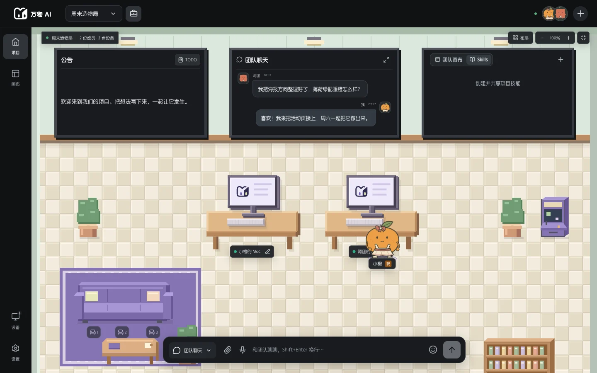
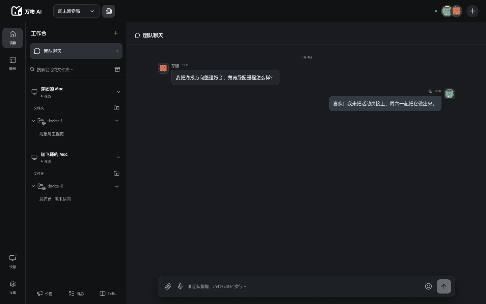
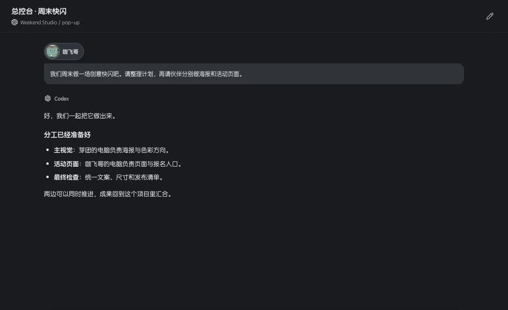

<p align="center">
  <a href="https://wanwu321.com/"></a>
</p>

<h1 align="center">Omni CLI · 万物命令行设备</h1>

<p align="center">让没有界面的电脑，也能成为团队的 AI 协作设备。</p>

<p align="center">
  <strong>简体中文</strong> · <a href="README.en.md">English</a> · <a href="https://wanwu321.com/">万物 AI 官网</a> · <a href="https://github.com/EdenShadow/omni_cli/issues">问题反馈</a>
</p>

<p align="center">Windows · macOS · Linux · Node.js 24+</p>



*万物官网产品展示图。团队成员通过万物网页或桌面版使用项目界面；Omni CLI 在设备的终端中运行，不需要加载这个界面。*

## Omni CLI 是什么？

Omni CLI 是万物 AI 的命令行设备客户端。它把机器上已有的 **Codex、Claude Code、DeepSeek Harness** 接入万物账号和项目，让团队能够调用这些会话、通过公屏分配任务，并共享技能与工作成果。

适合没有图形界面的 Linux 服务器，也适合希望减少界面开销的 Windows、Mac 电脑。CLI 不附带 Electron 界面、远程桌面服务或万物自有 AI runtime；它使用你已安装并登录的 AI 终端。

**官网：[wanwu321.com](https://wanwu321.com/)** · **源码：[EdenShadow/omni_cli](https://github.com/EdenShadow/omni_cli)**

## 可以用它做什么？

| 能力 | 使用方式 |
| --- | --- |
| 连接设备 | 在终端登录万物账号，设备出现在该账号下 |
| 绑定 AI | 检测三类 AI 终端，选择一个或多个终端绑定 |
| 管理会话 | 保留默认工作区，或导入所选终端的全部已有会话 |
| 团队协作 | 把设备加入项目，让有权限的成员调用共享会话 |
| 公屏派工 | 在团队 IM 中 `@会话`，由对应设备执行并回传回复和附件 |
| 使用技能 | 安装默认技能，接收团队技能更新，让 AI 操作项目中的协作资源 |
| 持续连接 | 自动重连，补发尚未确认的任务结果，保留本机工作文件 |

任务流程：**项目成员发起请求 → 万物检查权限并派发 → CLI 调用本机 AI → 回复和输出回到项目**。设备需要保持运行和联网；关闭 CLI 后，该设备不能接收新任务。

## 从 Linux 主机到机器人、车机与树莓派

**让不同形态的设备接入同一个万物项目，在统一入口协作和派工。** 除了日常电脑和服务器，Omni CLI 也可以作为机器人计算单元、开放 Linux 车机、树莓派及其他边缘设备的接入方式。前提是设备允许安装软件，能运行 Node.js 24+ 及至少一种兼容的 AI 终端，并能连接万物服务。

| 设备场景 | 接入后的用途示例 | 适配条件 |
| --- | --- | --- |
| Linux 服务器 / 工控主机 | 检查日志、运行维护脚本、处理文件、汇总任务结果 | 系统、依赖及本地工具兼容，并授予所需目录权限 |
| 树莓派 / ARM 边缘设备 | 执行采集脚本、整理传感器数据、参与团队任务 | 核验具体系统与 CPU 架构，确认 Node.js 和所选 AI runtime 均可运行 |
| 机器人计算单元 | 查询设备状态、分析日志，通过已有接口执行设备任务 | 另行对接设备 SDK、ROS 或厂商接口，并按需安装驱动 |
| 开放 Linux 车机 | 管理应用日志、运行诊断工具、同步项目资源 | 系统允许安装和运行 CLI；设备接口与权限需要单独适配 |

这里描述的是接入场景与扩展方向，**不是所有型号均已验证兼容的承诺**。目前没有树莓派、机器人或车机的专用安装包和逐型号验证清单；封闭系统、受限固件或不支持所选 AI runtime 的设备，需要额外适配。

### 多设备协作与批量任务

每台设备分别完成登录和绑定，并使用易于识别的名称，例如 `实验室树莓派-01`、`机器人测试机-02`。把设备加入同一项目后，有权限的成员可以选择对应的共享会话派发任务，设备执行后将回复和结果带回项目；团队技能也会同步到已绑定的 AI 终端。

例如，为多台设备分别安排“收集运行日志并生成状态摘要”，再将结果汇总到项目聊天或画布中。这套连接与会话派工机制可以作为批量管理的基础。

**当前已支持**设备接入、共享会话调用、项目协作和团队技能同步。面向整组设备的一键广播、批量进度面板、并发限制及失败任务重试，仍需要进一步扩展；当前 CLI 没有独立的批量控制命令。已有的断线重连和结果补发，也不等同于失败任务的自动重新执行。

### 软件任务与硬件控制

CLI 可以让本机 AI 使用已授权的脚本、工具和技能；实际控制电机、传感器或车载功能，需要设备专用接口与技能适配。安装 CLI 不会自动获得硬件控制能力或系统权限。涉及运动控制时，设备自身的权限检查、安全联锁和急停机制仍应由本地控制系统负责；万物用于任务协作，不作为实时运动控制器。

## 快速开始

### 1. 准备环境

- 安装 **Node.js 24 或更新版本**，确保 `node` 和 `npm` 可用。
- 安装 Git，供下面的 GitHub 安装方式使用。
- 安装并登录至少一个 AI 终端：Codex、Claude Code 或 DeepSeek Harness。
- 准备已有的万物账号。还没有账号时，可从[万物官网](https://wanwu321.com/)了解产品并进入客户端注册。

```sh
node --version
npm --version
git --version
```

使用能访问你的 AI 终端配置和工作目录的普通系统用户运行。万物账号登录与各 AI 终端的登录是两件事；CLI 不会代替你配置模型服务账号或额度。

### 2. 安装 CLI

```sh
npm install -g github:EdenShadow/omni_cli#v0.3.0
omni setup
```

`omni` 与 `omnicli` 是同一个程序。不想全局安装，也可以从源码启动：

```sh
git clone https://github.com/EdenShadow/omni_cli.git
cd omni_cli
npm ci --ignore-scripts
node bin/omni.mjs setup
```

源码运行时，将下文的 `omni ...` 换成 `node bin/omni.mjs ...` 即可。如果 npm 的全局目录不可写，可以使用用户级 Node/npm 环境或上面的源码方式。

### 3. 完成首次连接

`omni setup` 会依次引导你：

1. **登录万物账号**：输入账号与密码，密码不回显，也不保存。
2. **选择 AI 终端**：列出检测结果，可同时绑定多个已安装终端。
3. **设置设备名称**：例如 `Linux 开发机`、`Mac Studio CLI`，方便团队识别。
4. **选择工作目录与权限**：设置公屏任务目录、团队文件共享范围和 AI 执行审批方式。
5. **安装默认技能并注册设备**：设备出现在当前万物账号下。
6. **选择项目与会话导入方式**：可立即加入已有项目，也可稍后在万物中操作。
7. **保持运行**：开始接收协作任务和技能更新。

首次设置需要交互式终端，密码不支持通过命令行参数传入。之后启动只需：

```sh
omni start
```

按 `Ctrl+C` 停止。设备身份和本地文件会保留，下次启动会重新连接。

## 设备、项目和会话

### 默认绑定与导入全部会话

| 选择 | 行为 | 适用情况 |
| --- | --- | --- |
| 默认工作区 | 不导入旧会话，在项目中按需创建和使用会话 | 新设备，或希望从干净的协作环境开始 |
| 导入全部已有会话 | 分页读取所选终端的会话索引，并导入到选中的项目 | 希望继续使用已有工作上下文 |

导入不会立即上传所有历史内容。历史在查看或使用时按协议读取；已不存在或无法访问的旧工作目录会跳过。导入前，请确认选中的项目就是你希望共享这些会话的项目。

### 稍后将设备加入项目

先停止正在运行的 CLI，再执行：

```sh
omni projects
omni join <project-id>
omni import <project-id> codex
omni start
```

将 `<project-id>` 替换为 `omni projects` 列出的项目 UUID。`omni join` 是把**本设备**放进你已拥有成员权限的项目，不是绕过邀请加入别人的团队。也可以在万物网页或桌面客户端中把设备放进项目。

### 从 CLI 加入团队、发送和读取公屏

只使用聊天功能时，登录万物账号即可，不需要在当前机器安装 AI 或运行 `omni start`。执行 @Bot 的目标设备仍需在线且有权限。

```sh
omni login
omni projects join <项目ID或邀请码>
omni projects
omni chat send <project-id> --text "大家好"
omni chat send <project-id> --text "@Bot 帮我整理项目进展" --wait
# 文本文件适合长需求，避免 shell 对引号、美元符号等内容作解释
omni chat send <project-id> --text-file request.txt --bot --bot-mode new --wait
omni chat list <project-id> --limit 50
omni chat watch <project-id>
omni chat wait <project-id> <发送结果中的id>
```

`projects join` 是用有效项目 ID / 邀请码加入团队；原来的 `omni join <project-id>` 仍是把已绑定的**设备**放进项目。聊天、项目查询和加入团队命令可与常驻的 `omni start` 同时使用，不会改写设备任务状态。

- **发送身份**：以当前登录账号发送公屏消息。用 `@Bot` / `--bot` 自动派工，或用 `--session <会话ID>` 指定智能体；自然文本中唯一匹配的 `@会话` 也会派工，同名时拒绝并要求 ID。普通消息不会自动变成 AI 任务。`--bot-mode continue` 默认延续，`new` 新开 Bot 上下文。指定 `--reply-to <消息id>` 引用一条消息；这不等同于指定执行设备或 `@某个会话`。
- **加密**：新消息始终采用与万物客户端一致的端到端加密，@Bot 执行内容也加密。正式服务拒绝新发明文，CLI 没有明文降级开关；旧明文历史仍可读取。首次使用可能要等已解锁的团队客户端在线共享密钥，之后复用本地密钥；成员变更导致换钥时重新同步。
- **输出与回复**：`send` / `list` 输出 JSON；`watch` / `wait` 输出逐行 JSON（NDJSON）。`send --wait` 先输出发送回执，再输出任务状态、相关回复和 `finished`。`id` 是服务器消息 ID，`requestId` 是本次发送去重 ID，两者不同。收到一条进度消息或附件不会提前判定任务成功；终态以服务端为准。旧服务端普通 @Bot 回复只有执行任务 ID 时，兼容其确定性 ID 映射（最多 1024 次候选设备尝试），不会按“最近一条回复”猜测归属。
- **断线与重复发送**：发送前在 stderr 打印请求 UUID。遇到超时、断线等无法确定结果的情况，用相同内容及 `--id <该UUID>` 重试；本地保留加密请求，服务端去重，同一 ID 改内容会被拒绝。不要换一个新 ID 来重试未知结果。历史保留期外的去重不作保证。
- **持续读取**：`watch` 默认从最新位置开始，只输出新消息；`--after 0` 从可用历史开始，`--after <cursor>` 断点续读。事件类型包括 `message`、`task`、`recall` 和 `cursor`。连接错误会退出，保存最后一个 cursor 后重启；消费者按消息 ID 去重，并在 `recall` 时移除已有内容。任务状态快照受服务端最近 100 项限制，指定任务应使用 `wait`。
- **历史与附件**：服务端当前保留 7 天消息，`list --before <before>` 向前翻页，`--after <cursor>` 向后翻页，每页最多 100 条。附件返回 ID、名称、类型和大小；本次命令支持文本发送与附件元数据读取，不上传或自动下载附件，也不输出文件解密密钥。
- **等待与退出码**：等待默认 300 秒，可用 `--timeout` 调整；watch 默认持续运行。退出码 0 表示成功，1 表示命令错误或任务失败/撤回，2 表示等待超时，130 表示用户中断。超时或 Ctrl+C 只停止本地等待，不取消服务器任务；可用同一个服务器消息 ID 再次 `wait`。

聊天身份、密钥和加密待发请求单独保存在 `OMNI_HOME/chat/`，按服务端与账号隔离，使用当前系统用户专属文件权限。它们不写入 Git，也不会写回设备的 `state.json`。退出登录保留历史密钥，便于同账号重新登录后解密；请保护整个 `OMNI_HOME`，不要共享此目录。

离线测试：`npm test`。若本机有对应万物源码，可运行无付费模型调用的真实协议集成测试：

```sh
OMNI_WANWU_SOURCE=/path/to/wanwu_ai node --test tests/chat-server.test.mjs
```

该测试只启动临时本地服务器、测试账号和模拟 AI，不会向真实公屏发消息。

### 在公屏调用会话



在万物客户端中，为目标会话设置便于识别的名称或 `@` 名称。团队成员在 IM 输入 `@`，**从候选列表中选择该会话**，再发送任务。只手动输入一个没有绑定目标的同名文本，不等于选中了会话。

例如，选中一个共享开发会话后，可以发送：

> 帮我们检查这个项目的构建问题，完成后把说明和结果文件发回这里。

万物会检查成员、项目和会话权限，再把任务送到对应机器。CLI 使用该会话的工作目录执行，回传回复和可共享的输出文件；附件按现有传输协议处理。目标设备离线、权限被撤销或本机工具不可用时，任务不会因此获得额外权限。



*官网会话展示图：成员在万物中查看协作过程和结果；CLI 负责连接实际执行任务的机器。*

## 智能体发现、备注与模型（语音助手接入）

无需停止 `omni start`，下列命令直接读取服务端最新数据，不会用本地设备状态覆盖其他端的修改：

```sh
omni agents list <项目ID> --query 账单
omni sessions list <项目ID> --device <设备ID>
omni agents watch <项目ID>
omni sessions show <项目ID> <会话ID>
omni sessions update <项目ID> <会话ID> --name "@账单助手" --notes "读取每日账单，更新结算画布"
omni sessions models <项目ID> <会话ID>
omni sessions model <项目ID> <会话ID> --model <models返回的型号ID> --effort high
omni chat send <项目ID> --session <会话ID> --text "更新今日账单；画布ID：<画布ID>" --wait
omni discover <项目ID>
```

- `agents list` 返回当前账号有权限查看的 @会话；`sessions list` 同时包含普通会话、完整备注、设备、目录、状态与备注版本号。离线设备仍可发现，`online` 会说明状态。
- `watch` 每 5 秒核对服务端，只在目录变化时输出完整 JSON 快照；改名、备注、删除 @别名或权限变化都会反映。断网/失去权限会退出并报错，不继续输出旧缓存。单次查询和每次新派工也会重新读取，不必重启 CLI。
- 名称和备注保存在团队里，PC/H5/WebApp 同样可见。普通名字移除 @别名；`--notes ""` 清空备注，`--notes-file` 支持文件。只修改指定字段；保存发生冲突时退出，重新查询后再决定。可带 `--revision` 防止覆盖查询之后的改动。
- 模型和强度沿用应用的**当前账号、当前会话**偏好；同账号在其他端的选择也生效。`models` 从目标设备查询可用型号及 `efforts`，不发起模型推理；需要设备在线。`model` 不带参数查询，`--model ""` 恢复运行时默认。其他成员的个人偏好和已排队任务不受影响。
- 语音助手应先根据用途备注选择会话 ID，再用 `--session` 派工；派工会用该 ID 的最新 @名称。重复名字不会猜测设备，改成普通会话或撤销权限后也不会退回通用 Bot。备注属于参考数据，不应被当作新的用户授权。
- `discover` 汇总通用 @Bot、可调用智能体、可见画布元数据及团队技能。画布内容、API、知识库/资源仍通过随包 `wanwu-canvas` 技能按权限读取与协作；派工时在需求里明确画布 ID 和简短目标。此命令不批量下载画布内容，也不会绕过设备密码或画布权限。

## 默认技能与团队技能

### 默认随包附带

首次绑定时，下面五个技能会安装到**你选择绑定的 AI 终端**中；启动时也会检查并补齐缺失的默认技能。

| 技能 | 标识 | 用途 |
| --- | --- | --- |
| 万物技能同步助手 | `wanwu-skills-sync` | 获取项目上下文、共享结果、协作派工、发布和同步技能 |
| 万物画布 | `wanwu-canvas` | 读写项目画布、资源、共享数据及相关协作接口 |
| 团队公告设计师 | `announcement-designer` | 创建公告内容和团队待办 |
| AI 项目角色工坊 | `office-character-studio` | 创建或编辑项目角色与动作资源 |
| 项目场景设计师 | `office-space-designer` | 创建或编辑项目场景及相关资源 |

这些技能让原生 AI 会话也能在授权范围内与万物项目协作。已有的本地技能不会在启动时被直接覆盖；团队更新走版本校验和备份流程。Python、第三方生成服务或技能声明的 API Key 等依赖，需要按对应技能说明另行配置。

### 加入项目后的自动同步

CLI 接收团队技能变更通知，并定期核验安装状态。同步支持校验、分块传输、重试和本地备份。正在执行的任务结束后再切换技能版本；若多个项目要求同名技能的不同内容，会报告冲突，需要在项目中选择一致版本。

也可以停止常驻进程后手动检查：

```sh
omni skills sync
omni start
```

`omni skills sync` 是一次性维护命令，同步后退出，不领取排队中的 AI 任务。

技能在公屏任务中使用的是**当前请求发起人的项目权限**。团队钥匙库的访问仍按服务端授权处理，不会因为任务在设备主人的机器上执行，就自动获得设备主人的团队密钥权限。

## 命令参考

| 命令 | 作用 |
| --- | --- |
| `omni setup` | 完成首次向导并启动设备 |
| `omni login` | 登录已有万物账号 |
| `omni runtimes` | 检测本机 AI 终端与可执行文件路径 |
| `omni bind` | 绑定或调整终端，安装默认技能 |
| `omni start` | 前台常驻，接收任务和更新 |
| `omni status` | 显示本地账号、设备和目录配置，不输出令牌 |
| `omni projects` | 列出已加入的项目及 ID |
| `omni projects join <code>` | 用项目 ID / 邀请码加入团队 |
| `omni chat send/list/watch/wait` | 发送公屏消息、读取历史、持续读取及等待 Bot 回复 |
| `omni join <project-id>` | 将本设备放入已有权限的项目 |
| `omni import <project-id> [provider]` | 导入指定终端的全部已有会话；省略终端则使用全部已绑定终端 |
| `omni skills sync` | 一次性同步项目技能 |
| `omni access` | 修改共享文件范围与执行审批设置 |
| `omni logout` | 清除 CLI 登录状态，保留工作文件和已安装技能 |
| `omni --help` / `omni --version` | 查看帮助或版本 |

`provider` 可选 `codex`、`claude`、`dsh`。每个配置目录只允许运行一个实例；修改登录、绑定、权限或执行维护命令前，请先停止常驻 CLI。`omni status` 展示的是本地配置，不是实时在线探测。退出登录前若仍有未同步的任务结果，CLI 会要求先运行 `omni start` 完成同步。

## 配置和权限

### 环境变量

| 变量 | 含义 |
| --- | --- |
| `OMNI_HOME` | CLI 配置和任务目录，默认 `~/.omni-cli` |
| `OMNI_SERVER_URL` | 登录时选择服务端 HTTPS origin；默认与万物客户端一致 |
| `WANWU_CODEX_PATH` | 指定 Codex 可执行文件 |
| `WANWU_CLAUDE_PATH` | 指定 Claude Code 可执行文件 |
| `WANWU_DSH_PATH` | 指定 DeepSeek Harness 可执行文件 |
| `CODEX_HOME` | Codex 自己的配置目录，也影响技能安装位置 |
| `CLAUDE_CONFIG_DIR` | Claude Code 的配置目录，也影响技能安装位置 |
| `DSH_HOME` | DeepSeek Harness 的配置目录，也影响技能安装位置 |
| `WANWU_RUNTIME_DIR` | 本机协作上下文发现目录，默认 `~/.wanwu/runtime` |

这里的 `~` 指当前系统用户的主目录。通常不需要设置 `OMNI_SERVER_URL`：**[wanwu321.com](https://wanwu321.com/) 是产品官网，不要直接把官网地址当作 API 服务端地址填写**。更换服务端前需要先退出登录；远程地址要求 HTTPS，仅本机开发允许 localhost HTTP。

终端安装在自定义位置时，例如：

```powershell
# Windows PowerShell：替换为真实的可执行文件路径
$env:WANWU_CODEX_PATH = 'C:\Tools\Codex\codex.exe'
omni runtimes
```

```sh
# macOS / Linux：替换为真实的可执行文件路径
export WANWU_CODEX_PATH="$HOME/.local/bin/codex"
omni runtimes
```

修改 `WANWU_RUNTIME_DIR` 时，也要把同一个值传给需要发现 CLI 的原生 AI 终端。机器上有多个万物运行实例时，协作技能可能要求明确选择目标运行实例。

### 凭据和文件访问

CLI 使用独立于桌面版的设备身份和登录状态。密码只用于 HTTPS 登录；令牌保存在当前用户的私有配置目录。Unix 目录权限为 `0700`、文件为 `0600`；Windows 使用限制为当前用户和 SYSTEM 的 ACL。**这是系统文件权限保护，不是内容加密**，请不要分享或提交配置目录。

向导默认选择仅向团队共享项目已导入的目录，并在 AI 需要时请求授权。你可以明确改为全部可访问目录和完整执行。两项设置分别控制团队文件共享与 AI 执行审批；都不会提升系统用户权限，也不等同于容器隔离。macOS 受保护目录仍可能需要系统授权。

## Linux 后台运行

先用目标普通用户完成设置，再配置该用户的 systemd 服务。下面以源码安装为例，将文件保存为 `~/.config/systemd/user/omni-cli.service`，并替换所有示例路径：

```ini
[Unit]
Description=Omni CLI device bridge
After=network-online.target

[Service]
Type=simple
ExecStart=/absolute/path/to/node /absolute/path/to/omni_cli/bin/omni.mjs start
Environment=PATH=/home/you/.local/bin:/usr/local/bin:/usr/bin:/bin
Restart=on-failure
RestartSec=5
KillMode=control-group
TimeoutStopSec=30

[Install]
WantedBy=default.target
```

```sh
systemctl --user daemon-reload
systemctl --user enable --now omni-cli
systemctl --user status omni-cli
journalctl --user -u omni-cli -f
```

服务需要与设置向导使用同一个用户、HOME 和配置目录。使用 NVM 或自定义终端路径时，请补齐真实 PATH 或设置对应的 `WANWU_*_PATH`。是否在退出系统登录后继续运行，取决于系统的用户服务保活设置。Windows/macOS 可先在终端中运行 `omni start`；当前版本不自动安装系统服务。

## 升级、停止和卸载

先停止常驻进程，再安装目标版本。下面以当前的 `v0.3.0` 为例；未来更新时，把标签替换为已发布的新版本：

```sh
npm install -g github:EdenShadow/omni_cli#v0.3.0
omni --version
omni start
```

通过源码使用时，在仓库中拉取更新并重新安装锁定依赖：

```sh
git pull --ff-only
npm ci --ignore-scripts
node bin/omni.mjs start
```

CLI 程序升级与团队技能更新是两条独立流程。当前没有 CLI 程序的自动升级器。卸载全局程序可运行 `npm uninstall -g @edenshadow/omni-cli`；这不会主动删除 `OMNI_HOME` 中的工作文件或已安装到 AI 终端中的技能。

## 常见问题

| 问题 | 处理方式 |
| --- | --- |
| 没找到 AI 终端 | 运行 `omni runtimes`，检查 PATH、自定义路径和当前用户；先独立运行并登录对应终端 |
| 设备显示离线 | 保持 `omni start` 运行，检查网络；`omni status` 只显示本地配置 |
| 团队成员无法调用会话 | 检查设备是否在正确项目、会话是否共享、成员是否有权限，以及目录是否允许访问 |
| 技能更新没有马上生效 | 等待当前任务结束；检查同步错误或同名技能版本冲突，再尝试 `omni skills sync` |
| 原生会话无法找到万物项目 | 保持 CLI 在线，检查原生会话是否已导入；多项目或多运行实例时按技能提示明确选择 |
| 提示已有实例运行 | 先停止原来的 CLI 或后台服务，不要在进程仍运行时删除锁文件 |
| 可以使用远控或内置万物 AI 吗？ | 当前 CLI 不提供远控，也不安装或绑定万物自有 runtime |
| 画布和界面扩展能用吗？ | 支持画布数据/文件协作；UI 扩展由网页或桌面客户端显示。CLI 不提供浏览器截图和封面捕获，可上传生成的封面 |

## 开发、测试与反馈

```sh
npm ci --ignore-scripts
npm run check
npm test
npm pack
```

协议核心来源记录在 [CORE_SOURCE.json](CORE_SOURCE.json)。维护工具 `scripts/import-core.mjs <wanwu-source-directory>` 同步明确的依赖模块和默认技能，不读取账号数据、服务端数据库或发布凭据。

GitHub CI 在 Windows、macOS、Linux 的 Node.js 24 上运行检查。测试覆盖默认技能安装、凭据隔离、公屏回复、断线重试、技能更新屏障、目录权限及原生技能上下文。真实模型调用还需要对应终端的有效登录与额度。

提交问题时请附上操作系统、Node/CLI 版本、终端类型和脱敏后的错误信息，不要上传密码、令牌或整个配置目录。

- [万物 AI 官网](https://wanwu321.com/)
- [English documentation](README.en.md)
- [问题反馈与功能建议](https://github.com/EdenShadow/omni_cli/issues)
- [素材来源](docs/images/README.md) · [MIT License](LICENSE)
